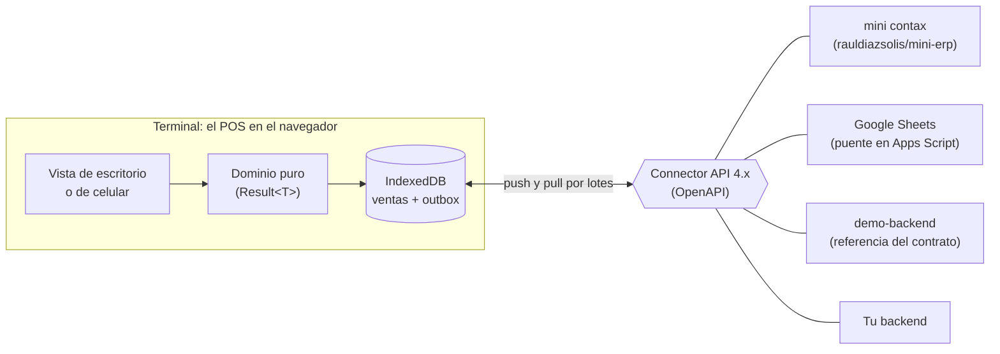

# offline-pos

[](https://github.com/rauldiazsolis/offline-pos/actions/workflows/publish.yml)
[](https://pos.contax.ar/v4/)
[](https://pos.contax.ar/v4/docs/)
[](https://pos.contax.ar)
[](./LICENSE)


**Punto de venta web offline-first para comercios minoristas** (kiosco, almacén, ferretería). Se
instala como PWA, vende sin conexión, se maneja 100% con teclado (y también con mouse o con el
celular) y se conecta con cualquier backend (ERP, e-commerce, una planilla) a través de un
contrato de API propio y versionado: el POS no conoce ningún backend en particular.

**Probalo**: [pos.contax.ar](https://pos.contax.ar) lista los backends con demo. "Abrir demo" en
mini contax abre una caja de prueba con catálogo y clientes de ejemplo, sin registrarse.

## Qué hace

- **Venta sin red**: la venta se cierra y se guarda en el navegador (IndexedDB); viaja al backend
  cuando hay conexión, sin perder nada aunque se cierre la pestaña.
- **Una barra de comandos**: código de barras, búsqueda por nombre, cantidades (`3*`), líneas libres
  (`bolsa$150`), descuentos (`-10%`), clientes (`@`) y comandos (`/COBRAR`, `/RESUMEN`, `/ANULAR`…).
- **Cobro** con seis medios de pago, cuenta corriente con reserva de crédito y cobranzas sin venta.
- **Caja sin turnos**: ingresos, egresos, arqueo y un resumen del día; numeración de tickets por caja.
- **Impresión** de tickets en 58 mm, 80 mm o A6.
- **Vista de celular** de la misma terminal, con teclados propios y lector de códigos con la cámara.
- **Modo entrenamiento** con una guía paso a paso, sobre una copia aparte de los datos.
- **Onboarding de demo**: de un link a una caja vendiendo, y de la demo al alta de un comercio real.

## Cómo encaja



- El **contrato** ([`docs/connector-api.openapi.yaml`](./docs/connector-api.openapi.yaml)) es el
  único acoplamiento: cualquier backend que lo implemente se conecta sin tocar el POS. El backend
  nunca rechaza una venta: registra todo y avisa.
- **[mini contax](https://mini.contax.ar)** ([rauldiazsolis/mini-erp](https://github.com/rauldiazsolis/mini-erp))
  es el backend multitenant que acompaña al POS: catálogo, stock, clientes, ventas y caja de cada
  comercio. Se desarrolla en su propio repo.
- **Google Sheets**: una planilla con un script hace de backend
  ([guía](./docs/integradores/google-sheets.md)).
- **[`demo-backend/`](./demo-backend)** es la referencia ejecutable del contrato (`pnpm backend`).

## Estado

En producción en [pos.contax.ar/v4/](https://pos.contax.ar/v4/), el canal del contrato 4.x: cada
versión llega sola a las terminales por el service worker. El MVP de mini contax (POS + mini) está
publicado y anda de punta a punta; lo que sigue y lo pendiente está en
[`AGENTS.md`](./AGENTS.md#estado-del-proyecto) y en los
[issues](https://github.com/rauldiazsolis/offline-pos/issues). Fuera de alcance por ahora: la
facturación fiscal y las pasarelas de pago.

## Desarrollo

Requiere Node 24 y pnpm 10.

```sh
pnpm install
pnpm dev          # el POS y el demo-backend juntos
```

| Comando                                                           | Qué hace                                                              |
| ----------------------------------------------------------------- | --------------------------------------------------------------------- |
| `pnpm lint` · `pnpm typecheck` · `pnpm test`                      | ESLint, TypeScript y Vitest                                           |
| `pnpm build`                                                      | Build de producción (con el service worker)                           |
| `pnpm test:e2e`                                                   | Playwright contra el build real                                       |
| `pnpm --filter pos-mobile run <typecheck\|test\|build\|test:e2e>` | Lo mismo para la vista de celular                                     |
| `pnpm backend` · `pnpm test:backend`                              | El demo-backend y sus tests                                           |
| `pnpm site:build` · `pnpm site:preview`                           | El sitio publicado (home de backends, canal y docs)                   |
| `pnpm release:tag`                                                | Crea y sube el tag de la versión de `package.json` (publica el canal) |

## Documentación

| Para                        | Documento                                                                                                                                       |
| --------------------------- | ----------------------------------------------------------------------------------------------------------------------------------------------- |
| Integrar un backend         | [Guía para integradores](./docs/integradores/guia.md), [OpenAPI](./docs/connector-api.openapi.yaml), [`llms.txt`](./docs/integradores/llms.txt) |
| Usar una planilla de Google | [Setup](./docs/integradores/google-sheets.md) y [referencia](./docs/integradores/google-sheets-referencia.md)                                   |
| Publicar una versión        | [`docs/publicacion.md`](./docs/publicacion.md)                                                                                                  |
| Trabajar en el código       | [`AGENTS.md`](./AGENTS.md) (y el de cada carpeta)                                                                                               |
| Entender una decisión       | Las specs de [`docs/superpowers/specs/`](./docs/superpowers/specs/) y [`docs/historia.md`](./docs/historia.md)                                  |
| La visión original          | [`pos-web-diseno-arquitectura.md`](./pos-web-diseno-arquitectura.md) (histórico)                                                                |

## Licencia

© 2026 Peky Diaz Solis. [GNU AGPL-3.0](./LICENSE). Podés usar, estudiar y modificar el código; si ofrecés una versión
modificada como servicio, tenés que publicar su código con la misma licencia.
